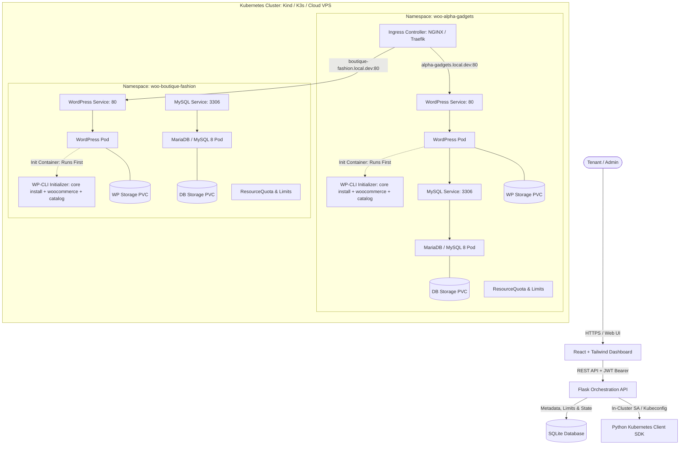

# WooForge K8s 🚀
### Production-Ready On-Demand WooCommerce Store Provisioning System for Kubernetes

[](https://kubernetes.io/)
[](https://python.org)
[](https://flask.palletsprojects.com/)
[](https://react.dev/)
[](https://tailwindcss.com/)
[](https://woocommerce.com/)

WooForge is an automated, multi-tenant Kubernetes platform that provisions isolated, fully configured WooCommerce stores on demand. Each store receives its own dedicated Kubernetes Namespace, isolated MySQL/MariaDB database, WordPress container, dedicated PersistentVolumeClaims (PVCs), strict resource quotas, and an automated **WP-CLI init container** that bootstraps WordPress core, activates WooCommerce, and seeds initial product catalogs before opening web traffic.

---

## 🏗️ Architecture & Tenant Isolation



### Key Architectural Pillars
1. **Per-Tenant Namespace Isolation**: Every provisioned store lives in its own Kubernetes namespace (`woo-<slug>`), isolating storage, secrets, configuration, and internal network endpoints.
2. **WP-CLI Init Container Bootstrap**:
   - The WordPress pod mounts a shared persistent volume at `/var/www/html`.
   - Before the Apache web server starts, the `wp-cli-init` init container downloads WordPress, waits for database readiness on `mysql:3306`, installs WordPress Core, installs and activates the `woocommerce` plugin and `storefront` theme, and seeds sample products according to the user's chosen catalog preset.
3. **Strict Resource Enforcement**: Every namespace is bounded with a Kubernetes `ResourceQuota` limiting maximum CPU, Memory, and PVC allocations to prevent "noisy neighbor" starvation.
4. **Resilient Backend & Status Poller**: A background worker continuously monitors Kubernetes pod lifecycles (`Pending`, `ContainerCreating`, `Running`, `CrashLoopBackOff`) and synchronizes live health state into SQLite for snappy UI polling.

---

## 📦 Directory Structure

```
.
├── backend/
│   ├── app.py                      # Flask REST API & background status sync worker
│   ├── auth.py                     # JWT authentication decorators & helpers
│   ├── catalog_presets.py          # Sample product catalog definitions & WP-CLI generator
│   ├── config.py                   # App & Kubernetes environment configuration
│   ├── Dockerfile                  # Production container for backend API
│   ├── k8s_client.py               # Kubernetes SDK client wrapper (render/apply/delete)
│   ├── models.py                   # SQLAlchemy schema (User, Store, SystemLimit)
│   ├── requirements.txt            # Python dependencies
│   ├── templates/
│   │   └── store_template.yaml.j2  # Complete Jinja2 K8s manifest for store namespace
│   └── test_api_and_manifests.py   # Automated integration test suite
├── frontend/
│   ├── index.html                  # Dashboard HTML entrypoint
│   ├── package.json                # React, Vite, Tailwind, Lucide dependencies
│   ├── vite.config.js              # Vite config with backend proxy
│   ├── tailwind.config.js          # Tailwind CSS styling configuration
│   └── src/
│       ├── App.jsx                 # Main application dashboard & state
│       ├── components/
│       │   ├── Navbar.jsx          # Top navigation & cluster status badge
│       │   ├── StatsOverview.jsx   # Resource quotas & store health metrics
│       │   ├── StoreCard.jsx       # Individual store cards with actions
│       │   ├── CreateStoreModal.jsx# Store creation form with catalog selector
│       │   ├── StoreDetailsModal.jsx# Pod diagnostics & WP-Admin credentials
│       │   └── AuthModal.jsx       # User login & registration
│       └── services/
│           └── api.js              # Axios HTTP client with JWT interceptors
├── k8s/
│   ├── kind-cluster.yaml           # Kind configuration with host ports 80/443 mapped
│   ├── backend-rbac.yaml           # ServiceAccount & ClusterRole for in-cluster API
│   └── backend-deployment.yaml     # Production K8s Deployment for the Flask API
├── .env.example                    # Sample environment configurations
├── .gitignore                      # Git ignore rules for Python, Node, DB & secrets
└── README.md                       # Architecture, Quickstart & Production guide
```

---

## 🗄️ Database Schema & API Reference

### Database Schema (SQLite)

```sql
-- Users Table
CREATE TABLE users (
    id INTEGER PRIMARY KEY AUTOINCREMENT,
    username VARCHAR(80) UNIQUE NOT NULL,
    email VARCHAR(120) UNIQUE NOT NULL,
    password_hash VARCHAR(255) NOT NULL,
    role VARCHAR(20) DEFAULT 'user',
    created_at DATETIME DEFAULT CURRENT_TIMESTAMP
);

-- System Limits Table (Per-user quotas)
CREATE TABLE system_limits (
    id INTEGER PRIMARY KEY AUTOINCREMENT,
    user_id INTEGER UNIQUE NOT NULL REFERENCES users(id),
    max_stores INTEGER DEFAULT 5,
    max_storage_per_store_gb INTEGER DEFAULT 5,
    max_memory_per_store_mb INTEGER DEFAULT 2048,
    max_cpu_cores_per_store FLOAT DEFAULT 2.0
);

-- Stores Table (Store metadata & status)
CREATE TABLE stores (
    id VARCHAR(36) PRIMARY KEY,
    user_id INTEGER NOT NULL REFERENCES users(id),
    name VARCHAR(100) NOT NULL,
    slug VARCHAR(60) UNIQUE NOT NULL,
    namespace VARCHAR(70) UNIQUE NOT NULL,
    domain VARCHAR(150) NOT NULL,
    status VARCHAR(30) NOT NULL DEFAULT 'PROVISIONING',
    status_message TEXT,
    storage_gb INTEGER DEFAULT 2,
    memory_mb INTEGER DEFAULT 1024,
    cpu_cores FLOAT DEFAULT 1.0,
    admin_username VARCHAR(80) DEFAULT 'admin',
    admin_password VARCHAR(100) NOT NULL,
    admin_email VARCHAR(120) NOT NULL,
    db_password VARCHAR(100) NOT NULL,
    catalog_preset VARCHAR(50) DEFAULT 'electronics',
    created_at DATETIME DEFAULT CURRENT_TIMESTAMP,
    updated_at DATETIME DEFAULT CURRENT_TIMESTAMP
);
```

### Core API Endpoints

| Method | Endpoint | Auth | Description |
| :--- | :--- | :--- | :--- |
| `POST` | `/api/auth/register` | Public | Register new user account with default limits |
| `POST` | `/api/auth/login` | Public | Authenticate user and return JWT access token |
| `GET` | `/api/auth/me` | JWT | Get current user profile and assigned limits |
| `GET` | `/api/stores` | JWT | List provisioned stores (Admin sees all stores) |
| `POST` | `/api/stores` | JWT | Provision new WooCommerce store stack in K8s |
| `GET` | `/api/stores/<id>` | JWT | Get store credentials and live K8s pod health |
| `GET` | `/api/stores/<id>/status` | JWT | High-frequency polling endpoint for frontend |
| `DELETE` | `/api/stores/<id>` | JWT | Teardown store namespace and associated PVCs |
| `GET` | `/api/presets` | Public | List available sample catalog presets |
| `GET` | `/api/system/limits` | JWT | Fetch allocated vs maximum storage and quotas |
| `GET` | `/api/system/cluster` | Public | Get Kubernetes cluster connectivity & nodes |

---

## 💻 Local Setup Guide (Kind & Kubectl)

### Prerequisites
- [Docker Desktop](https://www.docker.com/products/docker-desktop/) (running)
- [Kind](https://kind.sigs.k8s.io/) (`v0.20+`)
- [Kubectl](https://kubernetes.io/docs/tasks/tools/)
- [Python 3.11+](https://www.python.org/)
- [Node.js 18+](https://nodejs.org/)

---

### Step 1: Create Kind Cluster with Ingress Port Mappings
Create a local multi-node capable cluster where host ports 80 and 443 are forwarded into the cluster:

```bash
kind create cluster --name wooforge --config k8s/kind-cluster.yaml
```

Verify the cluster is active:
```bash
kubectl cluster-info --context kind-wooforge
```

---

### Step 2: Install Ingress-NGINX on Kind
Apply the official Ingress-NGINX controller tuned for Kind:

```bash
kubectl apply -f https://raw.githubusercontent.com/kubernetes/ingress-nginx/main/deploy/static/provider/kind/deploy.yaml
```

Wait until the ingress pods are in `Running` and `Ready` state:
```bash
kubectl wait --namespace ingress-nginx \
  --for=condition=ready pod \
  --selector=app.kubernetes.io/component=controller \
  --timeout=120s
```

---

### Step 3: Run the Backend API
1. Navigate to the `backend/` directory:
   ```bash
   cd backend
   ```
2. Install Python dependencies:
   ```bash
   pip install -r requirements.txt
   ```
3. Copy environment configuration:
   ```bash
   cp ../.env.example .env
   ```
4. Start the Flask API:
   ```bash
   python app.py
   ```
   > The API will boot on `http://127.0.0.1:5000` and automatically create the SQLite database with a demo admin account (`admin` / `admin123`).

---

### Step 4: Run the React Dashboard
1. Open a new terminal and navigate to `frontend/`:
   ```bash
   cd frontend
   npm install
   npm run dev
   ```
2. Open your browser to `http://localhost:3000`.
3. Sign in using the **One-Click Demo Admin** button or credentials `admin` / `admin123`.

---

### Step 5: Provision a Store & Local DNS Resolution
1. In the dashboard, click **"New Store"** and input:
   - Store Name: `Tech Gadgets`
   - Subdomain: `tech-gadgets`
   - Preset: `Electronics & Gadgets`
   - Click **Deploy Store**.
2. Watch the status transition in real-time:
   `PROVISIONING` (WP-CLI downloading core & seeding WooCommerce products) $\rightarrow$ `RUNNING`.
3. To access the store locally, route the domain `tech-gadgets.local.dev` to `127.0.0.1`:
   - On Windows, edit `C:\Windows\System32\drivers\etc\hosts`:
     ```
     127.0.0.1 tech-gadgets.local.dev
     ```
   - On Linux/macOS, edit `/etc/hosts`:
     ```
     127.0.0.1 tech-gadgets.local.dev
     ```
   - *Alternative without modifying hosts*: Set `BASE_DOMAIN=127.0.0.1.nip.io` in `.env`. Wildcard `*.127.0.0.1.nip.io` automatically resolves to your localhost!
4. Visit `http://tech-gadgets.local.dev` to view your live store with pre-populated WooCommerce catalog products!
5. Visit `http://tech-gadgets.local.dev/wp-admin` and copy the admin password from the dashboard's **Access & K8s** modal to enter the WordPress dashboard.

---

## 🌐 Production Deployment Guide (K3s on VPS)

For a production VPS (DigitalOcean Droplet, Hostinger VPS, Hetzner, or AWS EC2 running Ubuntu 22.04+):

### 1. Install K3s (Lightweight Kubernetes)
```bash
curl -sfL https://get.k3s.io | sh -s - --write-kubeconfig-mode 644
```

### 2. Wildcard DNS Configuration
Configure your domain registrar (e.g. Cloudflare, Namecheap) with a wildcard DNS record pointing to your VPS public IP:
```
A    *.store.yourdomain.com    ->    <YOUR_VPS_PUBLIC_IP>
```

### 3. Update WooForge Configuration
In `backend/.env`:
```ini
BASE_DOMAIN=store.yourdomain.com
INGRESS_CLASS=traefik     # Default for K3s
STORAGE_CLASS=local-path  # Default for K3s
K8S_AUTH_MODE=incluster   # When running inside K8s
```

### 4. Deploy WooForge to the Cluster
```bash
# 1. Apply RBAC permissions
kubectl apply -f k8s/backend-rbac.yaml

# 2. Deploy WooForge API
kubectl apply -f k8s/backend-deployment.yaml
```

---

## 🧪 Running Automated Tests

Run the full integration test suite covering JWT authentication, database schemas, and Jinja2 Kubernetes manifest rendering:

```bash
cd backend
python test_api_and_manifests.py
```

Expected output:
```
----------------------------------------------------------------------
Ran 3 tests in 0.576s

OK
```

---

## 🚀 Pushing to GitHub

To upload this project to your GitHub account:

1. **Recommended Repository Name**: `wooforge-k8s` (or `kube-woo-provisioner`)
2. Create a new empty repository on [GitHub](https://github.com/new).
3. From your project root directory, run:

```bash
# Initialize git if not already initialized
git init

# Add all files
git add .

# Commit changes
git commit -m "Initial commit: Production on-demand WooCommerce K8s provisioning system"

# Rename default branch to main
git branch -M main

# Link to your GitHub remote
git remote add origin https://github.com/<YOUR-USERNAME>/wooforge-k8s.git

# Push code to GitHub
git push -u origin main
```

---

## 📄 License
MIT License. Built for modern cloud & DevOps multi-tenant eCommerce infrastructure.
